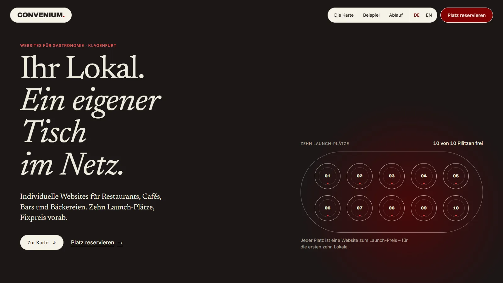
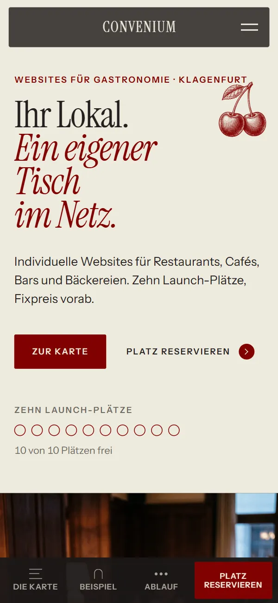
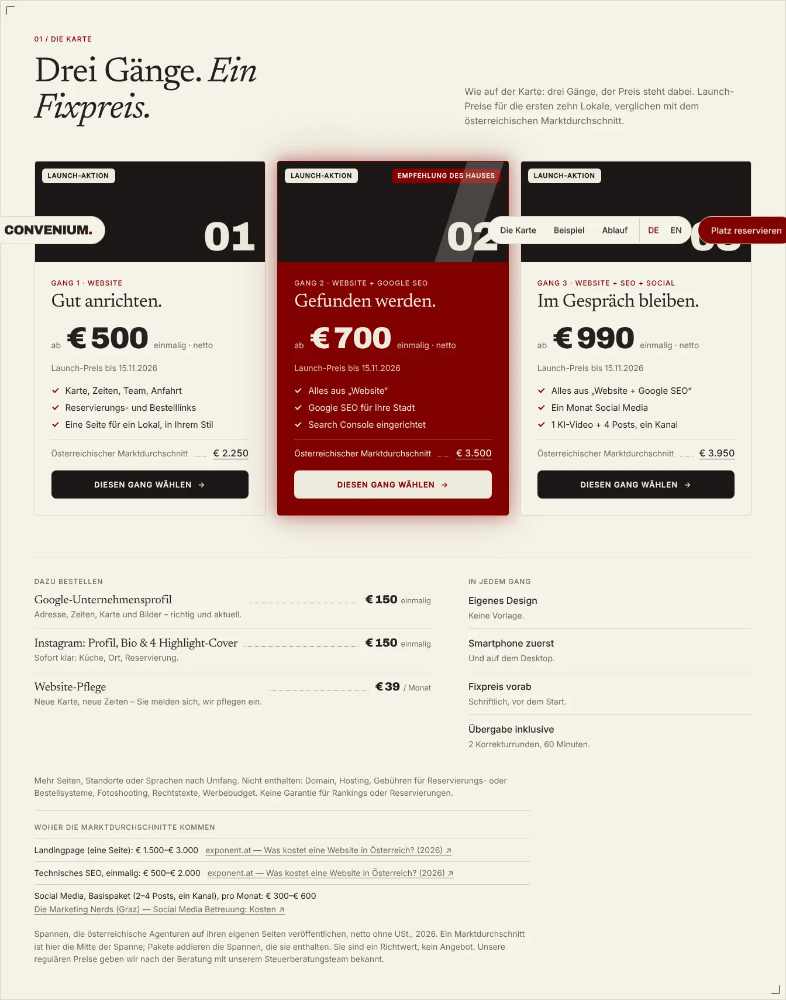
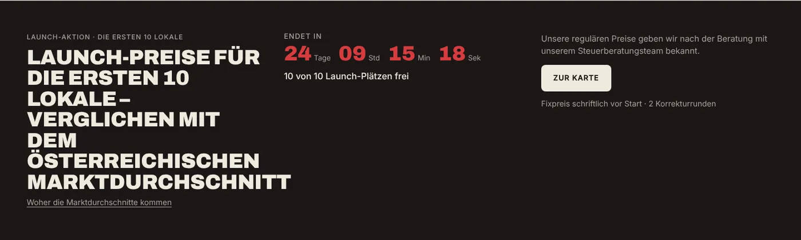

<p align="center">
  
</p>

<h1 align="center">Convenium · Gastronomie</h1>

<p align="center">Convenium Studio's landing page for restaurants, cafés, bars and bakeries: ten launch places at a fixed price, set like a menu card.</p>

<p align="center">
  <a href="https://convenium.at/gastronomy/"></a>
  
  
</p>

---

## Screens

<table>
  <tr>
    <td width="74%"></td>
    <td width="26%"></td>
  </tr>
</table>

<table>
  <tr>
    <td></td>
    <td></td>
  </tr>
</table>

## Direction — "Die Karte"

A dark dining room and a paper menu card. The ten launch places are a table seen from above, one plate
each, counted live from `content/campaign.json`. The three packages are three courses with dotted leaders
and the Austrian market average beside each. One real example: SAVRA, our restaurant concept build.

The design DNA was derived from what repeats across Awwwards' recognised restaurant sites in 2026 (dark
atmospheric grounds, editorial serifs, cream-and-red restraint, the menu as an interactive object, hover
reveals) and translated into the studio's own tokens — see `.olympus/06-build-plan.md` for the sources and
`DESIGN.md` for the numbers.

| Role | Typeface | Use |
|---|---|---|
| Voice | Newsreader | Every headline, leads, course titles |
| Numbers | Archivo | Prices, numerals, countdown, wordmark |
| Interface | Inter | Labels, body, controls |

Palette: the studio's noir · cotton · paper · ink · gray · hairline · cherry · maroon · chili. Nothing else.

## Stack

| Layer | Choice |
|---|---|
| Site | Static HTML/CSS/JS, rendered by `node build.mjs` from `content/*.json` (DE at `/`, EN at `/en/`) |
| Motion | GSAP 3.15 + ScrollTrigger, vendored in `assets/kit/vendor/`; no pins, no smooth-scroll library |
| Fonts | Archivo, Newsreader, Inter, self-hosted in `assets/kit/fonts/` |
| Security | CSP meta with one hashed inline script; `.htaccess` mirrors it as Report-Only on the host |

## Run locally

```bash
node build.mjs                                  # renders index.html, en/, the four legal pages, .htaccess
python -m http.server 4173 --directory .        # or: npx http-server . -p 4173
```

Open `http://localhost:4173/` and `http://localhost:4173/en/`. Edit `content/*.json`, `src/*.mjs`,
`styles.css`, `script.js`, `campaign.js`; the HTML files are build output.

## Deploy

Every push to `main` deploys to `https://convenium.at/gastronomy/` (`.github/workflows/deploy-godaddy.yml`,
rsync over SSH, never deletes) once the six GoDaddy secrets are set on this repository. GitHub Pages can
serve `main` as a staging mirror. A push is a deploy: Rustam's word only.

## Structure

```
index.html, en/index.html    DE and EN pages (generated)
impressum/, datenschutz/     legal pages, DE (generated); en/imprint/, en/privacy/ (generated)
content/                     de.json, en.json (copy), campaign.json (prices, places, clock), launch.json
src/                         render.mjs (page), legal.mjs (legal pages)
styles.css, script.js        the design and the interactions/motion
campaign.js                  launch prices, countdown, the plates
assets/                      kit (fonts, GSAP), savra (real capture of the concept site)
DESIGN.md, PRODUCT.md        the design system as numbers; what the page is for
.olympus/                    brief, build plan (research basis, beat sheet), QA log
```

## Status

Demo page: `noindex`, no data collection, the inquiry only prepares a text to copy. Legal fields are open
(`content/launch.json`), SAVRA is a concept build, not a client project.

---

<sub>Designed and built by Convenium Studio, Klagenfurt.</sub>
